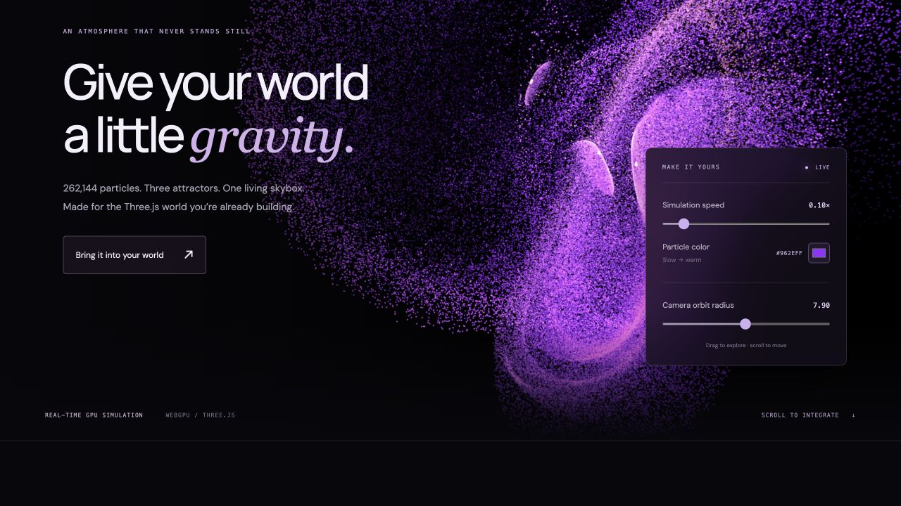

# Particles Skybox

A living particle skybox for a Three.js world. GPU attractors, six orbital capture cameras, and simulation warmup. Based on the original WebGPU renderer, with the full **Моя сцена** preset: three attractors, edited elliptical camera orbit, signed orbit/spin rates, colors and physical parameters.

**[Live demo](https://busovikov.github.io/particles-skybox/)** · [Preset](src/current-preset.json) · [License](LICENSE)



## Install

```sh
npm install three@0.180.0 github:busovikov/particles-skybox
```

The repository includes the built ES module in `dist/`. Three.js is a peer dependency and is not bundled into the library. Use the same Three.js version as your renderer; tested against r180. A renderer from `three/webgpu` is required, not `WebGLRenderer` from `three`.

## Add to your world

```js
import * as THREE from 'three/webgpu';
import { ParticleSkybox } from 'particles-skybox';

const renderer = new THREE.WebGPURenderer({ antialias: false });
renderer.setSize(window.innerWidth, window.innerHeight);
document.body.append(renderer.domElement);
const scene = new THREE.Scene();
const camera = new THREE.PerspectiveCamera(60, innerWidth / innerHeight, 0.01, 2000);
camera.position.set(0, 0.8, 4);
camera.lookAt(0, 0, 0);

// Add your normal meshes/lights to scene before or after this call.
const sky = await ParticleSkybox.create({
  renderer,
  scene,
  camera,
  warmup: 12,
  onProgress: fraction => console.log(`${Math.round(fraction * 100)}%`),
});

const timer = new THREE.Timer();
renderer.setAnimationLoop(timestamp => {
  timer.update(timestamp);
  sky.update(timer.getDelta(), camera);
  renderer.render(scene, camera);
});
```

`create()` initializes the renderer if needed, runs warmup, captures the texture and sets `scene.background`. It does not start an animation loop, move your camera or change renderer settings. Foreground objects render normally in your own scene. Translation of the viewer camera does not change the infinitely distant background; moving the capture orbit does.

The demo restores the **saved viewer pose**, too. To use that pose in your own project:

```js
import { currentPreset } from 'particles-skybox';
camera.position.fromArray(currentPreset.cameras.sky.position);
camera.quaternion.fromArray(currentPreset.cameras.sky.quaternion);
// With OrbitControls:
controls.target.fromArray(currentPreset.cameras.sky.target);
controls.update();
```

## Controls

```js
sky.setSpeed(0.1);              // 0–1; zero freezes physics and capture motion
sky.setColors('#962eff', '#ff9c66');
sky.cameraOrbitRadius = 8;      // mean of ellipse X/Z radii, world units
sky.cameraOrbit.speed = 0.006;  // signed radians per simulation second
sky.cameraOrbit.enabled = false;
sky.attractors[0].orbit.speed = 0.12;
sky.attractors[0].spinSpeed = 0.08;
```

Changing the orbit radius scales all axes proportionally, preserving the preset's ellipse and tilt. The landing demo exposes only speed, the slow-particle color and camera orbit radius; fast particles keep the preset's warm color.

## Warmup

```js
const controller = new AbortController();
const sky = await ParticleSkybox.create({
  renderer, scene, camera,
  warmup: 12,                  // simulation seconds, NOT wall-clock seconds
  signal: controller.signal,
  onProgress: fraction => { /* 0…1 */ },
});
// Or later, while the host loop is stopped:
await sky.warmup(6, { batchSize: 32, signal: controller.signal });
```

Warmup advances physics and all orbit/spin motion at 120 Hz regardless of playback speed. It yields to the browser between batches, skips intermediate cubemap captures, and captures once when ready. Do not run `update()` concurrently with `warmup()`. Cancellation during `create()` releases allocated resources. The accepted range is 0–300 simulation seconds. Particle buffers are initialized afresh: the preset saves settings and transforms, not a snapshot of GPU particles.

## Quality and lifecycle

```js
const sky = await ParticleSkybox.create({ renderer, scene, camera, resolution: 1024 });
sky.capture(camera, true); // force a refresh after host viewport/FOV changes
sky.dispose();             // restore previous background; release effect resources
```

The preset uses 262,144 particles, RGBA16F cube faces at 2048², no mipmaps, and no MSAA in the demo. Only viewer-visible faces are refreshed; turning the viewer on pause refreshes stale faces. Supply a camera to enable this optimization, or omit it to capture all six faces. Capture preparation is shared across faces. There is no per-frame CPU particle readback or depth sorting. The host owns the renderer, canvas, world objects, resize handling and render loop; the effect never disposes them. Repeated disposal is safe. One effect owns a scene background at a time.

`update(delta, camera)` takes **wall-clock seconds**, caps long gaps at 50 ms and applies playback speed once. Pause is `setSpeed(0)`. A WebGPU-capable browser and hardware acceleration are recommended. Three.js can select its WebGL2 backend, but performance and compatibility of that fallback are not guaranteed here. Device and viewport determine performance; this package makes no universal FPS claim.

## Develop and deploy

```sh
npm ci
npm test
npm run build       # dist/particles-skybox.js, external Three.js
npm run build:demo  # demo-dist/, relative assets for project GitHub Pages
npm run dev
npm pack
```

GitHub Actions builds/tests on `main` and deploys the demo to Pages. In the repository settings choose **Pages → Source → GitHub Actions**. The demo has no analytics, sign-in or external model downloads. Fonts fall back to system fonts if Google Fonts is unavailable.

## Attribution

Force equations originate in the Three.js compute-attractors example. See [THIRD_PARTY_NOTICES.md](THIRD_PARTY_NOTICES.md). This package does not depend on Spark; that experimental renderer is separate from this library.
